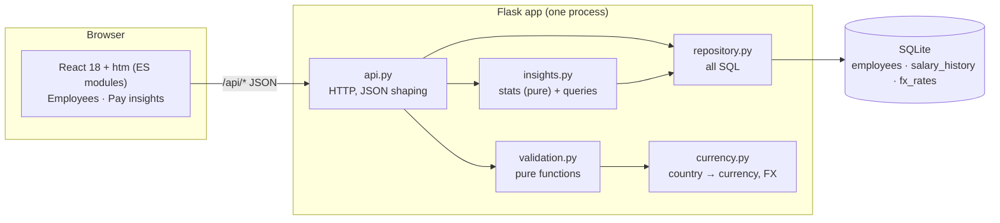

# Design notes, trade-offs & performance

## Architecture

Layering rule: **HTTP → validation / repository / insights → SQLite.** Validation and statistics are pure
functions (no DB, no Flask) so the most logic-heavy code is also the cheapest to test.
Flask serves the static UI too, so the whole product is one deployable unit.

## Data model
- `employees` — one row per person; `salary` is annual gross in whole **local-currency** units; `currency` is derived
  from `country` on the server (a client can never submit an inconsistent pair).
- `salary_history` — append-only; a row is written on hire and whenever salary or currency changes.
- `fx_rates` — USD per unit of each currency; joined at query time so a rate change applies retroactively.
- Indexes on `country`, `department`, `job_title`, `name` (the filter/sort columns); `email` is `UNIQUE … NOCASE`.

## Key decisions and trade-offs
| Decision | Alternative | Why this way |
|---|---|---|
| **SQLite** | Postgres | Brief suggests SQLite; 10k rows is tiny; zero-ops deploy. Trade-off: single-writer, so horizontal scale-out would need Postgres (SQL is plain, so porting is small). |
| **Salary in local currency + USD at query time** | Store USD only / convert on write | HR thinks in local pay; USD is needed only to compare. Converting at read time avoids stale numbers. Trade-off: a join per query (negligible, FX table has 11 rows). |
| **Whole-number salaries** | Decimal/cents | Annual salaries are whole units; avoids float-money pitfalls. Trade-off: no sub-unit precision. |
| **Percentiles computed in Python** | SQL window functions | SQLite has no percentile function. Fetching ≤10k `(group, salary)` rows and sorting is ~15–20 ms. Trade-off: would not scale to millions of rows (then: pre-aggregate or move to Postgres `percentile_cont`). |
| **Server-side pagination (max 100/page)** | Load all 10k to the client | Constant payload and render cost regardless of company size. |
| **Sorting by salary uses USD** | Sort by raw number | Otherwise 3,000,000 INR would outrank 150,000 USD. |
| **Median + P25/P75 range chart** | Averages only | Pay data is skewed; medians and quartiles are what HR actually discusses. |
| **React + htm via CDN, no build step** | Vite/Next | Zero toolchain, single deploy. Trade-off: no type checking / bundling, runtime CDN dependency (pinned versions). Upgrade path: move `js/` into Vite unchanged. |
| **Free-text department/job title with suggestions** | Fixed enums | HR can add new roles without a deploy; the lists are derived from data. Trade-off: typos can create near-duplicates. |
| **Hard delete** | Soft delete | Simple; deletion also removes history. A real HR system would likely archive instead. |

## Security notes
- All SQL is parameterised; sort/group columns come from whitelists (tested with an injection-style `sort` value).
- `LIKE` wildcards in search input are escaped (found and fixed by a test: `%` used to match everyone).
- **No authentication** (deliberately out of scope). Salary data is sensitive — auth/RBAC and audit logging must come before real use.

## Performance considerations
Measured with `backend/benchmark.py` on the seeded 10,000-employee DB (Flask test client, median of 20 runs, no network):

| Endpoint | Median |
|---|---|
| list page 1 | ~1 ms |
| list sorted by salary (JOIN + sort) | ~4 ms |
| list deep page (page 400) | ~5 ms |
| search by name/email | ~3 ms |
| filter country + department | ~3 ms |
| insights by country / job title | ~20 ms |
| salary distribution | ~14 ms |
| company summary | ~15 ms |

Why it is fast: indexed filters, `LIMIT/OFFSET` page of ≤100 rows, one aggregate pass per insight request, WAL mode.
Known limits and next steps: `LIKE '%q%'` search is a scan (fine at 10k; use FTS5 beyond ~100k);
`OFFSET` pagination slows on very deep pages (keyset pagination if needed); insights could be cached and
invalidated on write if traffic grew.

## Testing approach
`cd backend && make test` — 50 tests, ~0.5 s total, no network, no shared state (each API test gets its own temp SQLite file).
- Validation: pure unit tests incl. edge cases (bool-as-int, future dates, wildcard/whitespace handling).
- Statistics: percentile interpolation, order-independence, empty input.
- API: CRUD, uniqueness, history rules, filtering/sorting/pagination, insights, 404/422 paths.
- Seed: determinism, uniqueness, rows pass the same validation as the API.
